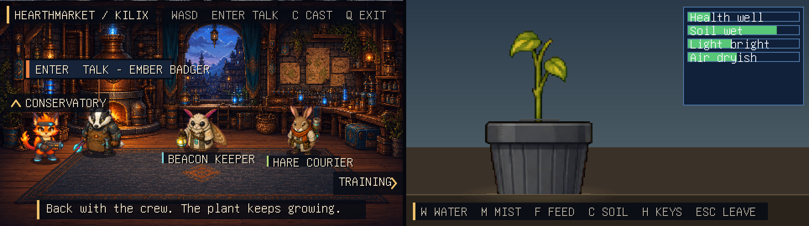

# Kilix Land

Kilix Land is a terminal-native conversation room that brings four Kilix game
casts together. Choose a protagonist and their three matching allies arrive
with them:

- **Legend of Kilix:** Kilix, Ember Badger, Beacon Keeper, and Hare Courier
- **Chumrunner:** Rook, Cipher, Patch, and Mara Velle
- **Kilix Fantasy:** Arden, Mira, Sol, and Tamsin
- **Pleb Bound:** Pip, Mo, Dot, and Beryl

Each selection also changes the room:

- **Legend of Kilix:** Hearthmarket beacon workshop
- **Chumrunner:** Null Market crew safehouse
- **Kilix Fantasy:** Emberlight guild common room
- **Pleb Bound:** Maple Loop repair-library workroom

Walk through the right edge of any room to enter that cast's training range.
The range uses a real backdrop and enemy atlas from the selected game, rolls a
random non-boss opponent from that game's roster, and gives the protagonist
their source-game standard attack. Opponents also advance or strafe, use their
authored attack pose, telegraph a captured target, deal source-game damage,
and reset the duel after knocking the protagonist out.

Walk up through the top-left of the social room, under the CONSERVATORY
marker, to reach the third location: a conservatory holding a real
[pleb-plant-grower](https://github.com/itsmygithubacct/pleb-plant-grower)
houseplant. It keeps growing on the wall clock while you are elsewhere in Land
or not playing at all, and it saves separately from the standalone game.


The rooms, proximity prompts, portrait cards, typewriter dialogue, progress
dots, and cast list are rendered with `kilix-ui`. PNG loading, validation,
caching, and atlas slicing go through `kilix-assets`; the 60 Hz input and
simulation loop follows the same `kilix-game-kit` and
`kilix-top-down-engine` integration used by `../legend-of-kilix`.

## Build and run

```sh
make
./kilix-land
```

Use a terminal with Kitty graphics support, such as Kilix, Kitty, Ghostty, or
WezTerm.

Controls:

- Up/Down or W/S in the cast menu: preview a different protagonist and crew.
- Enter or Space in the cast menu: start with the selected cast.
- Hold WASD or the arrow keys in the room: walk continuously.
- Walk through the right edge: enter the selected cast's training range.
- Walk up under the CONSERVATORY marker: enter the conservatory.
- Z in the training range: swing Kilix's rifle butt, Rook's pistol butt,
  Arden's Bronze Blade, or Pip's Bent Bat even when no target is in reach.
- Tap X as Kilix or Rook to enter aim mode. Move the 2D reticle with WASD
  or the arrow keys, then press Z to fire the exact displayed trajectory.
  Tap X or press Escape to cancel aim mode.
- R as Rook: reload the Ares Predator from the displayed reserve.
- Move clear of an enemy's red target marker before impact to dodge a ranged
  shot; keep space from melee opponents when they begin their lunge.
- Enter or Space near an ally: talk, reveal the current line, or continue.
- C: reopen the cast menu and switch the whole room cast.
- Escape: close dialogue, return from the cast menu, leave training or the
  conservatory, or exit from the social room.
- Q or Ctrl-C: exit.

In the conservatory the letters are the plant's care verbs, not movement.
A strip along the bottom names the ones in use, and H opens the full list:

- C check the soil, L lift the pot, W water, F feed, M mist, R rotate,
  P wipe the leaves, T trim, O repot, D empty the saucer, S sleeve in or out.
- K calendar, J journal, B plant label, H the key list.
- Arrows move through lists and the calendar; Enter chooses.
- Escape closes the key list, calendar, journal, or away report first, and
  otherwise walks back out to the crew.

Set `KILIX_LAND_ASSETS` to the project root if launching the executable from a
different working directory.

## Cast behavior


Each cast has its own research-grounded background, room title, names, colors,
portraits, and six conversation paths (a first and repeat exchange for each of
three allies), for 24 scripted exchanges across the four casts. Switching
casts changes the complete scene and resets conversation history so the new
crew starts fresh.

Kilix uses Legend of Kilix's byte-identical 16×8 player atlas, exact direction
rows, and native 64×64 draw size. Because its authored walk cells all hold one
stride, runtime movement now alternates a planted contact pose, that authored
step, another contact, and a lower-body-only opposite step.

The other three heroes use their games' exact 8×4 character sheets. Arden's and
Pip's down cycles keep every upper-body pixel fixed and alternately lift their
straight idle legs, preventing torso drift, angled walking, and sideways turns.
The authored side idle/walk poses remain oriented per source sheet (Rook faces
left; Arden and Pip face right), with runtime mirrors for the opposite
direction. Pip's upward steps mirror only the lower-body region, so equipment
and torsos stay fixed. Every pose is aligned by its upper-body spine and lowest
opaque foot pixel; held keys feed the fixed 60 Hz simulation directly.

## The conservatory



The conservatory embeds pleb-plant-grower as a library, following that game's
[`docs/EMBEDDING.md`](https://github.com/itsmygithubacct/pleb-plant-grower/blob/main/docs/EMBEDDING.md).
It is the `third_party/pleb-plant-grower` submodule, linked as
`libpleb-plant-grower.a`. Land keeps the terminal, the 60 Hz loop and the
mixer. The plant gets the canvas and the keys while the player is inside.
Everything that knows the plant's internals is in `src/conservatory.c`, and
`src/game.c` only ever sees `LAND_LOCATION_CONSERVATORY`.

- **Time.** Land hands the plant a fresh wall clock, boot clock, boot id and
  local UTC offset on every step. Biology advances once per wall second; on
  each entry the plant reconciles the time spent away and opens on a "while
  you were away" report when anything happened.
- **Saving.** The plant saves when you leave and when Land exits, under
  `$XDG_DATA_HOME/kilix-land/pleb-plant-grower/` (normally
  `~/.local/share/kilix-land/pleb-plant-grower/`). It never reads the
  standalone game's save, and Land ignores the standalone's
  `PLEB_PLANT_CONFIG_HOME` override. Without a usable home directory the
  plant still plays, but it does not persist.
- **Sound.** The plant's 17 cues play through Land's mixer from a bank of
  their own, since the four casts already fill 56 of the mixer's 64 cue slots.
  Plant UI cues use the UI bus; care sounds use the effects bus.
- **Assets.** The plant's sound bank and three procedural atlases are build
  products it keeps out of git. `make` runs the plant's own generators inside
  the submodule, which regenerate them byte for byte, and the submodule's
  `.gitignore` keeps them out of its status.
- **One SDK.** Host and archive share struct layouts, so both must be built
  from one `kilix-game-sdk` commit. Land exports its SDK checkout to the
  archive's sub-make, and `make sdk-check` (part of `make test`) fails if that
  commit differs from the one pleb-plant-grower itself pins. Land refuses to
  start if `pg_state_size()` disagrees with its own `sizeof(pg_state)`.

## Source-game combat parity

Training attacks are defined by the original games rather than a generic
Kilix Land combat formula:

- Kilix swings the rifle butt with Z at any distance. Holding X enters the
  source aiming stance; Z then fires the beam emitter and spends one of eight
  charges. Both use the source frame sequence, duration, and 0.18-second
  cooldown.
- Rook swings the Ares Predator's pistol butt with Z while not aiming,
  using his source Close Combat score and adjacent-cell rule. Holding X
  raises the pistol and Z fires it. Its source range/optimal-range hit chance, 12-round
  magazine, 20-round reserve, 15–18 raw damage, enemy armor, and minimum-one
  rule are all retained.
- Arden can always complete a full Bronze Blade swing. His current 17
  physical attack combines with Attack's power 13 and level bonus, then
  applies enemy defense, the source 95–105% roll, and its 1-in-16 critical.
  The renderer stitches the authored sword tip and slash trail across its
  atlas boundary so the entire blade remains visible.
- Pip can always swing the Bent Bat. In reach, Bash uses the live center,
  bounce, or double timing pattern from the selected Pleb Bound enemy. Bash
  retains Pip's current accuracy and critical chance, the grade bonuses,
  enemy evasion/defense, ±2 variance, and the source 1.5× critical.

Chumrunner, Kilix Fantasy, and Pleb Bound now route their own battle commands
through named versions of those same standard-attack calculations and retain
a short native action-pose state. Their enemy turns now retain the same
source damage/defense rules while exposing attacker, target, impact, and hurt
presentation. Legend of Kilix extends its rifle-butt/laser state machine with
dodgeable room-enemy target locks and knockout recovery. This keeps both sides
of combat testable in the main games as well as in Kilix Land.

### How parity is maintained

Kilix Land does not link the four complete game executables at runtime. Its
real-time room and training adapter lives in `src/game.c`, while the source
games remain authoritative for their rosters and combat data.
`tools/sync_source_parity.py` reads Legend of Kilix's combat constants plus the
Chumrunner, Kilix Fantasy, and Pleb Bound campaign files, generates
`src/source_parity.h`, copies all 17 source-owned
character/portrait/training/enemy assets byte-for-byte, refreshes their
dimensions and manifest hashes, and imports 49 native UI/combat cues from the
four games. Audio remains source-owned and byte-identical after the sync.

Every one of those reads goes through each source game's **published main**
(`origin/main`), never its working tree or whichever branch is checked out,
and the generated header records the four source commits it was built from.
A game part-way through an art or balance pass has files on disk, and often
commits on a work branch, that its own main has not accepted yet; without
this rule Land silently ships them, which is exactly how Arden's cast once
arrived here as unfinished 16×24 placeholder art. It also keeps every recorded
source commit fetchable by anyone with access to that game. Two cues predate
the same rule: Kilix Fantasy and Pleb Bound had no published `enemy_attack`
sound when it was introduced, so Land maps each game's attack swing to its
enemy turn.

A source game may also change the shape of its art, not only its numbers.
Land therefore declares each atlas's own column/row layout, and the check
fails whenever a copied sheet no longer divides into it — which is what a
source-side raster change looks like from here.

After a source game publishes to its main, fetch it and update Land:

```sh
git -C ../<source-game> fetch origin main
make parity-sync
```

The tool never touches the network, so `origin/main` is only as fresh as the
last fetch. A source game present without that ref fails the check rather
than skipping it.

`make test` begins with `make parity-check`, so stale generated data, copied
art, or manifest hashes fail immediately instead of silently drifting. Kilix
Land uses Legend of Kilix's ordinary source-atlas enemies as rapid one-hit
range targets. Spatial telegraphs, free 2D reticle movement, rapid respawns,
and one-player knockout recovery are Land presentation adapters around the
source calculations.

## Verify

```sh
make test
```

The test suite checks:

- that Land and pleb-plant-grower build from one `kilix-game-sdk` commit;
- menu wrapping, cast confirmation, all four cast profiles, and all 24
  first/repeat dialogue scripts;
- the conservatory door for every cast: entering only through the marked
  stretch of wall, the room standing still inside, and Escape returning the
  player beneath it;
- all 21 runtime graphics resources—including four social backgrounds, four
  source-game training backdrops, four enemy atlases, and the generated
  in-memory mirror cells;
- all 49 source-game WAV cues and all 17 plant cues through an offline mixer
  render;
- headless menu, room, and dialogue scenes;
- room and dialogue output for every cast under `build/cast-preview/`;
- source-enemy and in-progress attack output for every training range under
  `build/training-preview/`;
- 128 simulation-driven walking frames covering all four directions for every
  cast under `build/walk-preview/`;
- a conservatory session against a fixed clock and a private data root: Escape
  routing, a care verb and its sound, wall-clock aging, a byte-identical
  reload, three days away reconciled, a first run creating Land's data
  directory, and play without one;
- the door, the plant, its key list and calendar, and the plant at 800x450
  and 1280x720 under `build/conservatory-preview/`.

`make sanitize` rebuilds with clang's address and undefined-behavior
sanitizers, with leak detection on, and runs the same suite.

## Shared libraries

The shared libraries come from one recursive submodule,
`third_party/kilix-game-sdk`; `git submodule status` shows its pinned
revision. The conservatory's game is a second submodule,
`third_party/pleb-plant-grower`, pinned to a commit that uses the same SDK
revision. The four libraries Land builds against are reached through
symlinks beside it:

| Path | Target |
| --- | --- |
| `third_party/kilix-game-kit` | `kilix-game-sdk/kilix-game-kit` |
| `third_party/kilix-top-down-engine` | `kilix-game-sdk/kilix-top-down-engine` |
| `third_party/kilix-assets` | `kilix-game-sdk/kilix-assets` |
| `third_party/kilix-ui` | `kilix-game-sdk/kilix-ui` |

Clone with `--recurse-submodules`, or run
`git submodule update --init --recursive` in an existing checkout. The
top-level Makefile builds and links these libraries directly. Graphics
provenance is recorded in [`assets/graphics/README.md`](assets/graphics/README.md).
