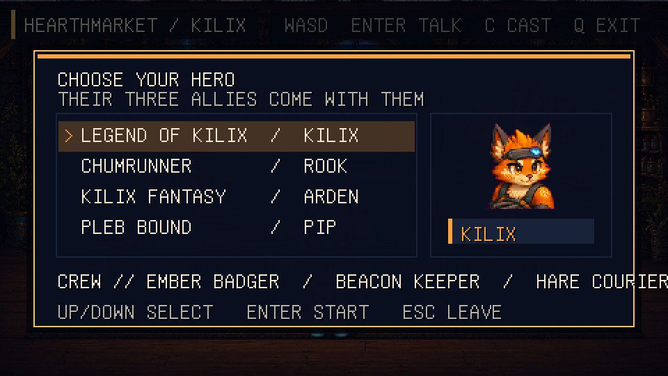
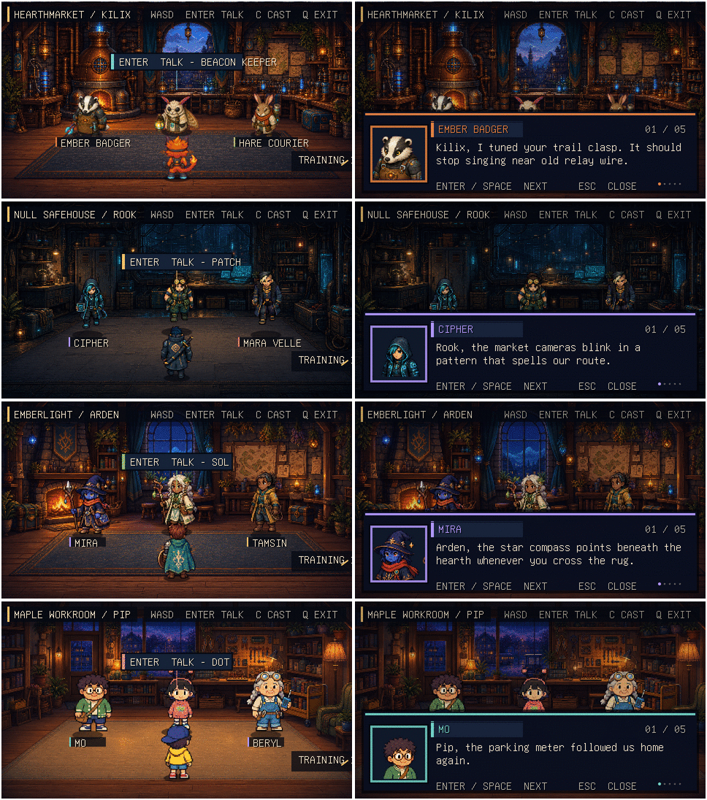

# Kilix Land

Kilix Land is a terminal-native conversation room that brings four Kilix game
casts together. Choose a protagonist and their three matching allies arrive
with them:

- **Legend of Kilix:** Kilix, Ember Badger, Beacon Keeper, and Hare Courier
- **Chumrunner:** Rook, Cipher, Patch, and Mara Velle
- **Kilix Fantasy:** Arden, Mira, Sol, and Tamsin
- **Pleb Bound:** Pip, Mo, Dot, and Beryl

Each selection also changes the room:

- **Legend of Kilix:** Hearthmarket beacon workshop
- **Chumrunner:** Null Market crew safehouse
- **Kilix Fantasy:** Emberlight guild common room
- **Pleb Bound:** Maple Loop repair-library workroom

Walk through the right edge of any room to enter that cast's training range.
The range uses a real backdrop and enemy atlas from the selected game, rolls a
random non-boss opponent from that game's roster, and gives the protagonist
their source-game standard attack. Opponents also advance or strafe, use their
authored attack pose, telegraph a captured target, deal source-game damage,
and reset the duel after knocking the protagonist out.



The rooms, proximity prompts, portrait cards, typewriter dialogue, progress
dots, and cast list are rendered with `kilix-ui`. PNG loading, validation,
caching, and atlas slicing go through `kilix-assets`; the 60 Hz input and
simulation loop follows the same `kilix-game-kit` and
`kilix-top-down-engine` integration used by `../legend-of-kilix`.

## Build and run

```sh
make
./kilix-land
```

Use a terminal with Kitty graphics support, such as Kilix, Kitty, Ghostty, or
WezTerm.

Controls:

- Up/Down or W/S in the cast menu: preview a different protagonist and crew.
- Enter or Space in the cast menu: start with the selected cast.
- Hold WASD or the arrow keys in the room: walk continuously.
- Walk through the right edge: enter the selected cast's training range.
- Z in the training range: swing Kilix's rifle butt, Rook's pistol butt,
  Arden's Bronze Blade, or Pip's Bent Bat even when no target is in reach.
- Tap X as Kilix or Rook to enter aim mode. Move the 2D reticle with WASD
  or the arrow keys, then press Z to fire the exact displayed trajectory.
  Tap X or press Escape to cancel aim mode.
- R as Rook: reload the Ares Predator from the displayed reserve.
- Move clear of an enemy's red target marker before impact to dodge a ranged
  shot; keep space from melee opponents when they begin their lunge.
- Enter or Space near an ally: talk, reveal the current line, or continue.
- C: reopen the cast menu and switch the whole room cast.
- Escape: close dialogue, return from the cast menu, leave training, or exit
  from the social room.
- Q or Ctrl-C: exit.

Set `KILIX_LAND_ASSETS` to the project root if launching the executable from a
different working directory.

## Cast behavior



Each cast has its own research-grounded background, room title, names, colors,
portraits, and six conversation paths (a first and repeat exchange for each of
three allies), for 24 scripted exchanges across the four casts. Switching
casts changes the complete scene and resets conversation history so the new
crew starts fresh.

Kilix uses Legend of Kilix's byte-identical 16×8 player atlas, exact direction
rows, and native 64×64 draw size. Because its authored walk cells all hold one
stride, runtime movement now alternates a planted contact pose, that authored
step, another contact, and a lower-body-only opposite step.

Rook and Pip use their games' exact 8×4 painted sheets. Pip's down cycle keeps
every upper-body pixel fixed and alternately lifts his straight idle legs,
preventing torso drift, angled walking, and sideways turns; Rook's reuses his
authored stride. Arden's sheet is different in kind: Kilix Fantasy now ships
true SNES 16×24 field cells with all eight poses authored, so Land replays its
front walk, back, attack, and knocked-out cells byte-for-byte at a whole-number
4× block scale — square source pixels, and the same on-screen height as the
other casts' painted sheets — instead of synthesizing any of them.

The authored side idle/walk poses remain oriented per source sheet (Rook faces
left; Arden and Pip face right), with runtime mirrors for the opposite
direction. Pip's upward steps mirror only the lower-body region, so equipment
and torsos stay fixed. Every pose is aligned by its upper-body spine and lowest
opaque foot pixel; held keys feed the fixed 60 Hz simulation directly.

## Source-game combat parity

Training attacks are defined by the original games rather than a generic
Kilix Land combat formula:

- Kilix swings the rifle butt with Z at any distance. Holding X enters the
  source aiming stance; Z then fires the beam emitter and spends one of eight
  charges. Both use the source frame sequence, duration, and 0.18-second
  cooldown.
- Rook swings the Ares Predator's pistol butt with Z while not aiming,
  using his source Close Combat score and adjacent-cell rule. Holding X
  raises the pistol and Z fires it. Its source range/optimal-range hit chance, 12-round
  magazine, 20-round reserve, 15–18 raw damage, enemy armor, and minimum-one
  rule are all retained.
- Arden can always complete a full Bronze Blade swing. His current 17
  physical attack combines with Attack's power 13 and level bonus, then
  applies enemy defense, the source 95–105% roll, and its 1-in-16 critical.
  The swing shows Kilix Fantasy's own standard-attack cell, and its opponents
  use the source bestiary's idle, acting, and collapsed poses.
- Pip can always swing the Bent Bat. In reach, Bash uses the live center,
  bounce, or double timing pattern from the selected Pleb Bound enemy. Bash
  retains Pip's current accuracy and critical chance, the grade bonuses,
  enemy evasion/defense, ±2 variance, and the source 1.5× critical.

Chumrunner, Kilix Fantasy, and Pleb Bound now route their own battle commands
through named versions of those same standard-attack calculations and retain
a short native action-pose state. Their enemy turns now retain the same
source damage/defense rules while exposing attacker, target, impact, and hurt
presentation. Legend of Kilix extends its rifle-butt/laser state machine with
dodgeable room-enemy target locks and knockout recovery. This keeps both sides
of combat testable in the main games as well as in Kilix Land.

### How parity is maintained

Kilix Land does not link the four complete game executables at runtime. Its
real-time room and training adapter lives in `src/game.c`, while the source
games remain authoritative for their rosters and combat data.
`tools/sync_source_parity.py` reads Legend of Kilix's live combat constants,
Kilix Fantasy's atlas-layout constants, and the current Chumrunner, Kilix
Fantasy, and Pleb Bound campaign files, generates `src/source_parity.h`,
copies all 17 source-owned character/portrait/training/enemy assets
byte-for-byte, refreshes their dimensions and manifest hashes, and imports 49
native UI/combat cues from the four games. Audio remains source-owned and
byte-identical after the sync.

A source game may also change the shape of its art, not only its numbers.
Land therefore declares each atlas's own column/row layout, and the check
fails whenever a copied sheet no longer divides into it — which is what a
source-side raster change looks like from here.

After changing a source game, update Land with:

```sh
make parity-sync
```

`make test` begins with `make parity-check`, so stale generated data, copied
art, or manifest hashes fail immediately instead of silently drifting. Kilix
Land uses Legend of Kilix's ordinary source-atlas enemies as rapid one-hit
range targets. Spatial telegraphs, free 2D reticle movement, rapid respawns,
and one-player knockout recovery are Land presentation adapters around the
source calculations.

## Verify

```sh
make test
```

The test suite checks:

- menu wrapping, cast confirmation, all four cast profiles, and all 24
  first/repeat dialogue scripts;
- all 21 runtime graphics resources—including four social backgrounds, four
  source-game training backdrops, four enemy atlases, and the generated
  in-memory mirror cells;
- all 49 source-game WAV cues through an offline mixer render;
- headless menu, room, and dialogue scenes;
- room and dialogue output for every cast under `build/cast-preview/`;
- source-enemy and in-progress attack output for every training range under
  `build/training-preview/`;
- 128 simulation-driven walking frames covering all four directions for every
  cast under `build/walk-preview/`.

## Shared-library checkouts

| Checkout | Revision |
| --- | --- |
| `third_party/kilix-game-kit` | `91594b2d8f49` |
| `third_party/kilix-top-down-engine` | `3340f91eb356` |
| `third_party/kilix-assets` | `db347356644a` |
| `third_party/kilix-ui` | `9bb17ff683c6` |

These are recursive Git checkouts, not flattened source copies. The top-level
Makefile builds and links them directly. Graphics provenance is recorded in
[`assets/graphics/README.md`](assets/graphics/README.md).
