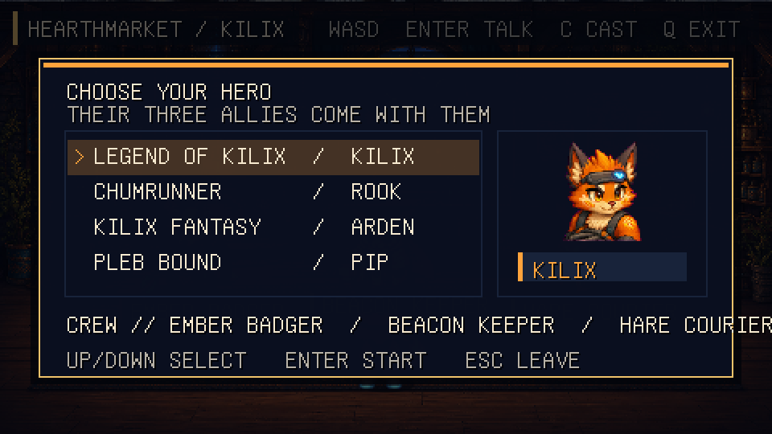

# Kilix Land

Kilix Land is a terminal-native conversation room that brings four Kilix game
casts together. Choose a protagonist and their three matching allies arrive
with them:

- **Legend of Kilix:** Kilix, Ember Badger, Beacon Keeper, and Hare Courier
- **Chumrunner:** Rook, Cipher, Patch, and Mara Velle
- **Kilix Fantasy:** Arden, Mira, Sol, and Tamsin
- **Pleb Bound:** Pip, Mo, Dot, and Beryl

Each selection also changes the room:

- **Legend of Kilix:** Hearthmarket beacon workshop
- **Chumrunner:** Null Market crew safehouse
- **Kilix Fantasy:** Emberlight guild common room
- **Pleb Bound:** Maple Loop repair-library workroom

**Status:** installable on demand from the Kilix content catalog (catalog id
`kilix-land`, kind `game`): `kilix games play kilix-land` installs, builds and
starts it, and the Kilix 95 Games menu offers it from the same catalog. The
catalog pinned by Kilix for Plebian-OS 0.2.3 (release candidate `v0.2.3-rc6`)
selects commit `710d73ef` on the `release/0.2.2-coordinated` branch; `main`,
the default branch documented here, carries rebased equivalents of those
commits and differs from the pin in two lines (`src/render.c` and the
`pleb-plant-grower` gitlink).

Walk through the right edge of any room to enter that cast's training range.
The range uses a real backdrop and enemy atlas from the selected game, rolls a
random non-boss opponent from that game's roster, and gives the protagonist
their source-game standard attack. Opponents also advance or strafe, use their
authored attack pose, telegraph a captured target, deal source-game damage,
and reset the duel after knocking the protagonist out.

Walk up through the top-left of the social room, under the CONSERVATORY
marker, to reach the third location: a conservatory holding a real
[pleb-plant-grower](https://github.com/itsmygithubacct/pleb-plant-grower)
houseplant. It keeps growing on the wall clock while you are elsewhere in Land
or not playing at all, and it saves separately from the standalone game.



The rooms, proximity prompts, portrait cards, typewriter dialogue, progress
dots, and cast list are rendered with `kilix-ui`. PNG loading, validation,
caching, and atlas slicing go through `kilix-assets`; the 60 Hz input and
simulation loop follows the same `kilix-game-kit` and
`kilix-top-down-engine` integration used by `../legend-of-kilix`.

## What it does

- Puts a protagonist and three allies from one of four Kilix game casts in a
  cast-specific room, with portrait cards and typewriter dialogue (24 scripted
  exchanges in all).
- Opens each cast's training range with a real backdrop, a random non-boss
  enemy from that game, and the protagonist's source-game standard attack.
- Hosts a living pleb-plant-grower houseplant in a conservatory that keeps
  growing on the wall clock and saves separately from the standalone game.
- Plays the source games' own sound cues through one mixer, and runs entirely
  offline.

## Build and run

```sh
make
./kilix-land
```

Use a terminal with Kitty graphics support, such as Kilix, Kitty, Ghostty, or
WezTerm.

Controls:

- Up/Down or W/S in the cast menu: preview a different protagonist and crew.
- Enter or Space in the cast menu: start with the selected cast.
- Hold WASD or the arrow keys in the room: walk continuously.
- Walk through the right edge: enter the selected cast's training range.
- Walk up under the CONSERVATORY marker: enter the conservatory.
- Z in the training range: swing Kilix's rifle butt, Rook's pistol butt,
  Arden's Bronze Blade, or Pip's Bent Bat even when no target is in reach.
- Tap X as Kilix or Rook to enter aim mode. Move the 2D reticle with WASD
  or the arrow keys, then press Z to fire the exact displayed trajectory.
  Tap X or press Escape to cancel aim mode.
- R as Rook: reload the Ares Predator from the displayed reserve.
- Move clear of an enemy's red target marker before impact to dodge a ranged
  shot; keep space from melee opponents when they begin their lunge.
- Enter or Space near an ally: talk, reveal the current line, or continue.
- C: reopen the cast menu and switch the whole room cast.
- Escape: close dialogue, return from the cast menu, leave training or the
  conservatory, or exit from the social room.
- Q or Ctrl-C: exit.

In the conservatory the letters are the plant's care verbs, not movement.
A strip along the bottom names the ones in use, and H opens the full list:

- C check the soil, L lift the pot, W water, F feed, M mist, R rotate,
  P wipe the leaves, T trim, O repot, D empty the saucer, S sleeve in or out.
- K calendar, J journal, B plant label, H the key list.
- Arrows move through lists and the calendar; Enter chooses.
- Escape closes the key list, calendar, journal, or away report first, and
  otherwise walks back out to the crew.

Set `KILIX_LAND_ASSETS` to the project root if launching the executable from a
different working directory.

## Usage

| Command | Effect |
| --- | --- |
| `kilix games play kilix-land` | install from the catalog if needed, then play |
| `./kilix-land` | run a local build |
| `./kilix-land --version` | print the version |
| `make` | build the game and the plant's generated assets |
| `make test` | parity check, SDK check, then every headless self-test and render |
| `make sanitize` | rebuild with address and undefined-behavior sanitizers and test |
| `make parity-check` / `make parity-sync` | verify / regenerate data copied from the source games |

The in-game controls are listed under [Build and run](#build-and-run).

## How it works

```text
 kilix-land (C11)
   ├── src/game.c          rooms, dialogue, training range (60 Hz loop)
   ├── src/conservatory.c  embeds libpleb-plant-grower.a
   ├── src/source_parity.h generated from the source games' published main
   └── third_party/kilix-game-sdk
         kilix-game-kit, kilix-top-down-engine, kilix-assets, kilix-ui
                 │
                 ▼
   Kitty graphics frames + Kitty keyboard input in the terminal
```

Kilix Land is one C11 executable. The rooms, prompts, portraits and dialogue
are drawn with `kilix-ui`, images load through `kilix-assets`, and the input
and simulation loop come from `kilix-game-kit` and `kilix-top-down-engine`,
all from the `kilix-game-sdk` submodule. It does not link the four source
games: `tools/sync_source_parity.py` copies their rosters, combat constants,
art and cues from each game's published `main` into a generated header and
asset set, and `make test` fails if that copy is stale
([docs/casts-and-combat.md](docs/casts-and-combat.md)). The conservatory links
pleb-plant-grower as a library and hands it the canvas, keys and clock while
the player is inside ([docs/conservatory.md](docs/conservatory.md)).

## Documentation

| Document | Contents |
| --- | --- |
| [docs/casts-and-combat.md](docs/casts-and-combat.md) | cast animation, source-game combat parity and how it is maintained |
| [docs/conservatory.md](docs/conservatory.md) | the embedded houseplant: time, saving, sound, assets, one SDK |
| [docs/development.md](docs/development.md) | what `make test` checks, and the shared-library layout |
| [assets/graphics/README.md](assets/graphics/README.md) | graphics provenance |
| [assets/LICENSE](assets/LICENSE) | the asset licence |

## Related repositories

- [kilix-game-sdk](https://github.com/itsmygithubacct/kilix-game-sdk#readme):
  the shared runtime, rendering, UI and asset libraries (`third_party/kilix-game-sdk`).
- [pleb-plant-grower](https://github.com/itsmygithubacct/pleb-plant-grower#readme):
  the conservatory's plant (`third_party/pleb-plant-grower`).
- [kilix-content](https://github.com/itsmygithubacct/kilix-content#readme):
  the catalog entry that installs it, and
  [Kilix](https://github.com/itsmygithubacct/kilix#readme), whose
  `kilix games play` launches it.
- [kilix-land-desktop](https://github.com/itsmygithubacct/kilix-land-desktop#readme):
  the Kilix Land desktop provider, a walkable desktop that plays like this game.
- [kilix-land-agent](https://github.com/itsmygithubacct/kilix-land-agent#readme):
  a resident agent in a Kilix Land studio room.

## Part of Plebian-OS

Kilix Land is one of the repositories behind
[Plebian-OS](https://github.com/itsmygithubacct/plebian-os#readme), a Debian
install whose desktop is [Kilix](https://github.com/itsmygithubacct/kilix#readme)
running the [Kilix 95](https://github.com/itsmygithubacct/kilix-95#readme)
desktop through [Pleb](https://github.com/itsmygithubacct/pleb#readme).
It is installed on demand from the Kilix content catalog. The map of every
repository and how it ships is on the
[components page](https://github.com/itsmygithubacct/plebian-os/blob/main/docs/components.md).

## License

The source code is MIT; see [LICENSE](LICENSE). Everything under `assets/`
(atlases, backdrops, portraits and audio cues) is CC BY-NC-SA 4.0; see
[assets/LICENSE](assets/LICENSE).
