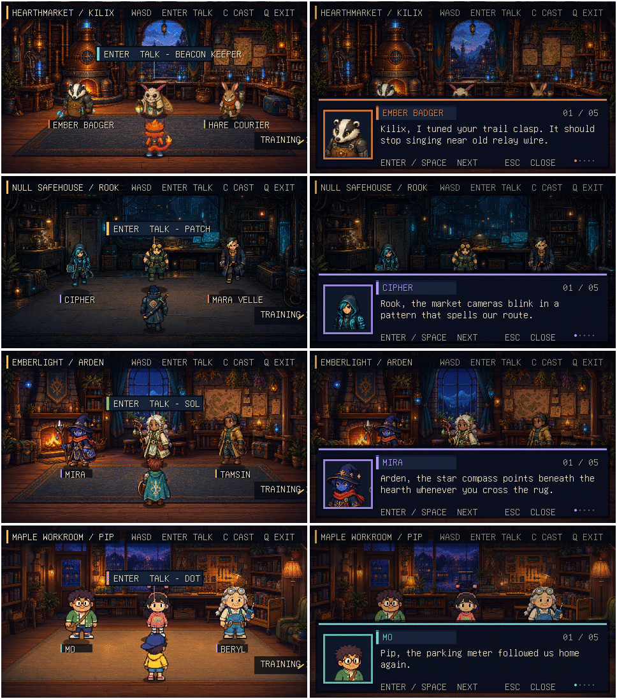

# Kilix Land casts and source-game combat

How each cast is animated and how training-range combat follows the source games, including how that parity is kept. Moved from the [README](../README.md); the text is unchanged.

## Cast behavior



Each cast has its own research-grounded background, room title, names, colors,
portraits, and six conversation paths (a first and repeat exchange for each of
three allies), for 24 scripted exchanges across the four casts. Switching
casts changes the complete scene and resets conversation history so the new
crew starts fresh.

Kilix uses Legend of Kilix's byte-identical 16×8 player atlas, exact direction
rows, and native 64×64 draw size. Because its authored walk cells all hold one
stride, runtime movement now alternates a planted contact pose, that authored
step, another contact, and a lower-body-only opposite step.

The other three heroes use their games' exact 8×4 character sheets. Arden's and
Pip's down cycles keep every upper-body pixel fixed and alternately lift their
straight idle legs, preventing torso drift, angled walking, and sideways turns.
The authored side idle/walk poses remain oriented per source sheet (Rook faces
left; Arden and Pip face right), with runtime mirrors for the opposite
direction. Pip's upward steps mirror only the lower-body region, so equipment
and torsos stay fixed. Every pose is aligned by its upper-body spine and lowest
opaque foot pixel; held keys feed the fixed 60 Hz simulation directly.

## Source-game combat parity

Training attacks are defined by the original games rather than a generic
Kilix Land combat formula:

- Kilix swings the rifle butt with Z at any distance. Holding X enters the
  source aiming stance; Z then fires the beam emitter and spends one of eight
  charges. Both use the source frame sequence, duration, and 0.18-second
  cooldown.
- Rook swings the Ares Predator's pistol butt with Z while not aiming,
  using his source Close Combat score and adjacent-cell rule. Holding X
  raises the pistol and Z fires it. Its source range/optimal-range hit chance, 12-round
  magazine, 20-round reserve, 15–18 raw damage, enemy armor, and minimum-one
  rule are all retained.
- Arden can always complete a full Bronze Blade swing. His current 17
  physical attack combines with Attack's power 13 and level bonus, then
  applies enemy defense, the source 95–105% roll, and its 1-in-16 critical.
  The renderer stitches the authored sword tip and slash trail across its
  atlas boundary so the entire blade remains visible.
- Pip can always swing the Bent Bat. In reach, Bash uses the live center,
  bounce, or double timing pattern from the selected Pleb Bound enemy. Bash
  retains Pip's current accuracy and critical chance, the grade bonuses,
  enemy evasion/defense, ±2 variance, and the source 1.5× critical.

Chumrunner, Kilix Fantasy, and Pleb Bound now route their own battle commands
through named versions of those same standard-attack calculations and retain
a short native action-pose state. Their enemy turns now retain the same
source damage/defense rules while exposing attacker, target, impact, and hurt
presentation. Legend of Kilix extends its rifle-butt/laser state machine with
dodgeable room-enemy target locks and knockout recovery. This keeps both sides
of combat testable in the main games as well as in Kilix Land.

### How parity is maintained

Kilix Land does not link the four complete game executables at runtime. Its
real-time room and training adapter lives in `src/game.c`, while the source
games remain authoritative for their rosters and combat data.
`tools/sync_source_parity.py` reads Legend of Kilix's combat constants plus the
Chumrunner, Kilix Fantasy, and Pleb Bound campaign files, generates
`src/source_parity.h`, copies all 17 source-owned
character/portrait/training/enemy assets byte-for-byte, refreshes their
dimensions and manifest hashes, and imports 49 native UI/combat cues from the
four games. Audio remains source-owned and byte-identical after the sync.

Every one of those reads goes through each source game's **published main**
(`origin/main`), never its working tree or whichever branch is checked out,
and the generated header records the four source commits it was built from.
A game part-way through an art or balance pass has files on disk, and often
commits on a work branch, that its own main has not accepted yet; without
this rule Land silently ships them, which is exactly how Arden's cast once
arrived here as unfinished 16×24 placeholder art. It also keeps every recorded
source commit fetchable by anyone with access to that game. Two cues predate
the same rule: Kilix Fantasy and Pleb Bound had no published `enemy_attack`
sound when it was introduced, so Land maps each game's attack swing to its
enemy turn.

A source game may also change the shape of its art, not only its numbers.
Land therefore declares each atlas's own column/row layout, and the check
fails whenever a copied sheet no longer divides into it — which is what a
source-side raster change looks like from here.

After a source game publishes to its main, fetch it and update Land:

```sh
git -C ../<source-game> fetch origin main
make parity-sync
```

The tool never touches the network, so `origin/main` is only as fresh as the
last fetch. A source game present without that ref fails the check rather
than skipping it.

`make test` begins with `make parity-check`, so stale generated data, copied
art, or manifest hashes fail immediately instead of silently drifting. Kilix
Land uses Legend of Kilix's ordinary source-atlas enemies as rapid one-hit
range targets. Spatial telegraphs, free 2D reticle movement, rapid respawns,
and one-player knockout recovery are Land presentation adapters around the
source calculations.
