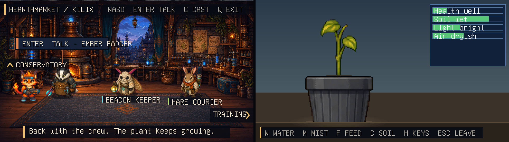

# The Kilix Land conservatory

How Kilix Land embeds pleb-plant-grower as its third location. Moved from the [README](../README.md); the text is unchanged.

## The conservatory

The conservatory embeds pleb-plant-grower as a library, following that game's
[`docs/EMBEDDING.md`](https://github.com/itsmygithubacct/pleb-plant-grower/blob/main/docs/EMBEDDING.md).
It is the `third_party/pleb-plant-grower` submodule, linked as
`libpleb-plant-grower.a`. Land keeps the terminal, the 60 Hz loop and the
mixer. The plant gets the canvas and the keys while the player is inside.
Everything that knows the plant's internals is in `src/conservatory.c`, and
`src/game.c` only ever sees `LAND_LOCATION_CONSERVATORY`.

- **Time.** Land hands the plant a fresh wall clock, boot clock, boot id and
  local UTC offset on every step. Biology advances once per wall second; on
  each entry the plant reconciles the time spent away and opens on a "while
  you were away" report when anything happened.
- **Saving.** The plant saves when you leave and when Land exits, under
  `$XDG_DATA_HOME/kilix-land/pleb-plant-grower/` (normally
  `~/.local/share/kilix-land/pleb-plant-grower/`). It never reads the
  standalone game's save, and Land ignores the standalone's
  `PLEB_PLANT_CONFIG_HOME` override. Without a usable home directory the
  plant still plays, but it does not persist.
- **Sound.** The plant's 17 cues play through Land's mixer from a bank of
  their own, since the four casts already fill 56 of the mixer's 64 cue slots.
  Plant UI cues use the UI bus; care sounds use the effects bus.
- **Assets.** The plant's sound bank and three procedural atlases are build
  products it keeps out of git. `make` runs the plant's own generators inside
  the submodule, which regenerate them byte for byte, and the submodule's
  `.gitignore` keeps them out of its status.
- **One SDK.** Host and archive share struct layouts, so both must be built
  from one `kilix-game-sdk` commit. Land exports its SDK checkout to the
  archive's sub-make, and `make sdk-check` (part of `make test`) fails if that
  commit differs from the one pleb-plant-grower itself pins. Land refuses to
  start if `pg_state_size()` disagrees with its own `sizeof(pg_state)`.
